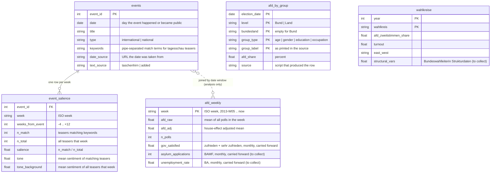

# Data model (processed layer)

Target tables in `data/processed/`, built by `src/preprocessing/` from the per-source CSVs in `data/interim/`.
Each table keeps its natural grain. Joins happen inside the analysis, not in storage.

Research question: *How can the growth of the AfD be explained?*
- Q1: Which international and national events had a significant impact on the AfD's success?
- Q2: How has the demographic profile of AfD voters changed?

## Diagram

## Tables

| Table | Grain | Built from | Serves |
|---|---|---|---|
| `afd_weekly` | one row per ISO week | `surveys_bund.csv`, `regierungszufriedenheit.csv`, controls to collect | Q1 outcome and controls |
| `events` | one row per event | `events_taschenhirn.csv` plus dates and keywords added by `src/preprocessing/events.py` | Q1 treatments |
| `event_salience` | one row per event and week | `events`, `tagesschau_archiv.csv`, `tagesschau_sentiment.csv` | Q1 exposure |
| `afd_by_group` | one row per election, level, group type, group | `btw_gender_age.csv`, `btw_education.csv`, `ltw_age.csv`, `ltw_gender.csv`, `ltw_education.csv`, `tagesschau_umfrage-*.csv` | Q2 descriptive trend |
| `wahlkreise` | one row per Wahlkreis and election | `btw_wahlkreise.csv`, structural data to collect | Q2 regression and map |

## Notes

- **House effects** (`afd_adj`): each institute's mean deviation from the all-institute mean over the whole period is subtracted before averaging by week. The offsets are written to the decisions log.
- **Monthly controls** are carried forward to the weeks of the month they cover. This is stated wherever they are used.
- **Salience** is a share within the week, never a count, because the archive grows roughly tenfold between 2013 and 2025. `n_match` and `n_total` are kept so small denominators are visible.
- **Event summaries** (peak salience, salience summed over a window) are derived from `event_salience` at the end of the pipeline, not stored on `events`, so there is one definition.
- **`afd_by_group`** replaces the five wide interim tables with one long table. Group labels are kept as printed; harmonisation (e.g. 16-29 vs 18-29) is an analysis decision.
- **Mixed grains** are intended: Q1 is answered at weekly grain, Q2 at election grain. The two meet only in the dashboard.
