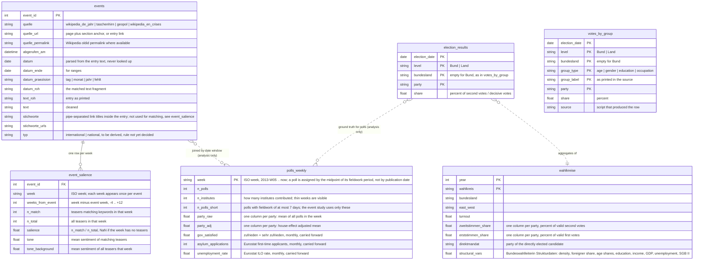

# Data model (processed layer)

Target tables in `data/processed/`, built by `src/preprocessing/` from the per-source CSVs in `data/interim/`.
Each table keeps its natural grain. Joins happen inside the analysis, not in storage.
All party tables carry every party, not only the AfD, so shifts between parties (e.g. AfD to BSW in 2024) stay visible.

Research question: *How can the growth of the AfD be explained?*
- Q1: Which international and national events had a significant impact on the AfD's success?
- Q2: How has the demographic profile of AfD voters changed?

Standard party columns everywhere: `CDU/CSU, SPD, Grüne, FDP, Linke, AfD, BSW, FW, Sonstige` (plus `SSW` and others where they occur).

## Diagram

## Tables

| Table | Grain | Built from | Serves |
|---|---|---|---|
| `polls_weekly` | one row per ISO week | `surveys_bund.csv`, `regierungszufriedenheit.csv`, `controls_monthly.csv` | Q1 outcome (all parties) and controls |
| `events` | one row per event | `events_wikipedia_jahr.csv` (main), `events_taschenhirn.csv`, `events_geopol.csv`, `events_wikipedia_crises_en.csv`, concatenated and de-duplicated | Q1 treatments |
| `event_salience` | one row per event and week | `events`, `tagesschau_archiv.csv`, `tagesschau_sentiment.csv` | Q1 exposure. Built by `build_event_salience.py`, currently in `data/interim/event_salience_weekly.csv` plus a per-event summary `event_salience_summary.csv` (terms used, peak_share, baseline_share, salience, flag); candidate for processed |
| `votes_by_group` | one row per election, level, group type, group, party | `btw_gender_age.csv`, `btw_education.csv`, `ltw_age.csv`, `ltw_gender.csv`, `ltw_education.csv`, `tagesschau_umfrage-{alter,job,werwas,afd}.csv` | Q2 descriptive trend, flows between parties within a group |
| `election_results` | one row per election, level, bundesland, party | `btw_results.csv`, `ltw_results.csv` | ground truth vs polls; Q1 and Q2 context |
| `wahlkreise` | one row per Wahlkreis and election | `btw_wahlkreise.csv` (Erst- und Zweitstimmen, Direktmandat), `btw_strukturdaten.csv` (join on constituency name after dash normalisation, or number) | Q2 regression, map, direct mandates |

## Notes

- **Poll timing.** Institutes publish on different weekdays and field their surveys over different periods, so a poll is dated by the midpoint of its fieldwork period (`Zeitraum` in surveys_bund.csv), which is when opinion was measured, not by the publication date. Six of eight institutes field within 3 to 7 days and publish the next day; Allensbach fields about 14 days and publishes a week later, Verian up to 21 days. Each poll keeps a `fieldwork_days` value; the weekly series uses all polls, the event study only polls with fieldwork of at most 7 days, because a two-week poll cannot show a reaction to an event inside that window (about 5 % of polls, nearly all Allensbach).
- **House effects** (`party_adj`): each institute's mean deviation from the all-institute mean, per party, over the whole period is subtracted before averaging by week. This also removes the composition problem: a week with only INSA and a week with Forsa and Allensbach would otherwise differ even with no change in opinion. The offsets are written to the decisions log.
- **Area naming** is the same in every table: `level` is Bund or Land, `bundesland` is the state name and empty for Bund. No table uses "Bundesgebiet" as a value.
- **Monthly controls** are carried forward to the weeks of the month they cover. This is stated wherever they are used.
- **Salience** is a share within the week, never a count, because the archive grows roughly tenfold between 2013 and 2025. `n_match` and `n_total` are kept so small denominators are visible. One row is one calendar week; `weeks_from_event` only aligns events on a common axis (week 0 = event week) so their coverage curves can be compared.
- **Event summaries** are derived from `event_salience`, not stored on `events`, so there is one definition: `salience` = peak share in week 0 or +1 minus the mean share of weeks -4 to -1. Match terms are the stems of the event text that burst in the event week (see decisions 2026-10-13), stored per event in `terms` with their burst factor.
- **Events are never hand-entered.** Every row comes from one of four scraped sources and carries its URL, permalink, fetch time, raw text and the raw date fragment. Keywords (`stichworte`) are the Wikipedia link titles inside the entry, not written by us. AfD-internal events are out of scope by decision; domestic policy debates are to be detected from the tagesschau archive. Classification into international and national is still open.
- **`votes_by_group`** replaces the five wide interim tables with one long table with a `party` column. Group labels are kept as printed; harmonisation (e.g. 16-29 vs 18-29) is an analysis decision.
- **`wahlkreise`** gives 299 observations per federal election instead of 16 states, which is what makes a regression of party share on constituency characteristics possible, and drives the map in the dashboard.
- **Mixed grains** are intended: Q1 is answered at weekly grain, Q2 at election grain. The two meet only in the dashboard.
