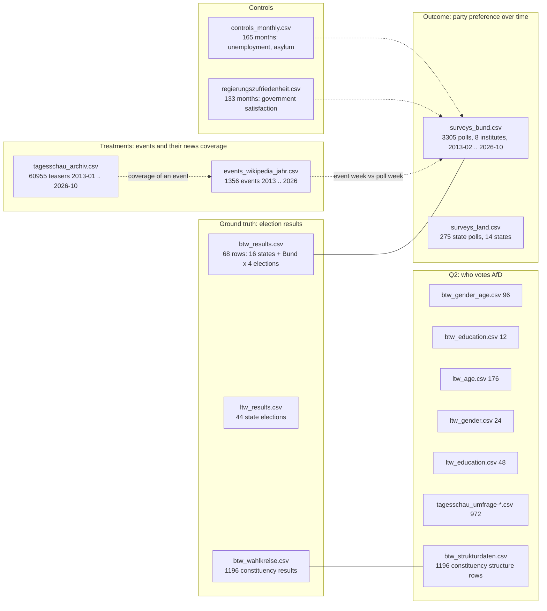

# Data model

Research question: *How can the growth of the AfD be explained?*
- Q1: Which international and national events had a significant impact on the AfD's success?
- Q2: How has the demographic profile of AfD voters changed?

Two parts. **Part 1** is the data model of deliverable 1: the datasets as collected, one CSV per source in `data/interim/`,
with their variables and meaning. This is what the two-page report quantifies. **Part 2** is the prospective processed layer
for deliverables 2 and 3 (weekly poll series, event salience, long tables), which is built from Part 1 by `src/preprocessing/`
and may still change.

Standard party columns everywhere: `CDU/CSU, SPD, Grüne, FDP, Linke, AfD, BSW, FW, Sonstige` (plus `SSW` and others where they occur).
Dates are ISO strings, numbers plain floats; exceptions are listed under "Known deviations".

## Part 1: Deliverable 1, the collected datasets (interim layer)

Every file is written by exactly one scraper in `src/scraping/`, from a raw download kept in `data/raw/`. Nothing is hand-entered.
Row counts as of 2026-10-20; sources, URLs and scrape dates are in `docs/sources.md`.

Dotted lines are joins that happen in the analysis (Part 2), not in storage. The only direct key between files is
`Jahr` + `Wahlkreis` between `btw_wahlkreise.csv` and `btw_strukturdaten.csv` (names need dash normalisation, see decisions 2026-10-12).

### Polls (Q1 outcome)

| File | Grain | Rows | Variables |
|---|---|---|---|
| `surveys_bund.csv` | one poll (institute x publication date) | 3305 | `Institut` (Allensbach, Forsa, Forschungsgruppe Wahlen, GMS, INSA, Infratest dimap, Verian, YouGov); `Datum` publication date; `Zeitraum` fieldwork period as printed ("04.09.–16.09."); `Befragte` sample size; vote shares in percent for the standard parties plus `PIRATEN`, `Nichtwähler/ Unentschl.` where the institute reports them; parties an institute did not report are NaN |
| `surveys_land.csv` | one state poll | 275 | same layout plus `Bundesland`; 14 states |

### Election results (ground truth, Q1 and Q2 context)

| File | Grain | Rows | Variables |
|---|---|---|---|
| `btw_results.csv` | election year x area | 68 | `Jahr` (2013, 2017, 2021, 2025); `Gebiet` (16 states and the federal territory); `Wahlberechtigte`, `Wählende`; `Erststimmen <party>` and `Zweitstimmen <party>` as percent of valid votes |
| `btw_wahlkreise.csv` | election year x constituency | 1196 | `Jahr`, `Wahlkreis`, `Wahlberechtigte`, `Wählende`, `Direkt gewählter Abgeordnete` (party of the winner), `Erststimmen <party>`, `Zweitstimmen <party>`; a party that did not stand is empty, not 0 |
| `ltw_results.csv` | state election | 44 | `Bundesland`, `Datum`, party shares in percent incl. `SSW`, `BIW` |

### Events and their news coverage (Q1 treatments)

| File | Grain | Rows | Variables |
|---|---|---|---|
| `events_wikipedia_jahr.csv` | one list item of the "Ereignisse" section of the German Wikipedia year article | 1356 | provenance: `quelle`, `quelle_url` (page + section anchor), `quelle_permalink` (oldid), `abgerufen_am`; position: `jahr`, `abschnitt` (Politik und Weltgeschehen, Wirtschaft, Katastrophen, ...), `unterabschnitt` (D-A-CH, Europa, Terroranschläge, ...), `verschachtelt`; date: `datum`, `datum_ende`, `datum_praezision` (tag 1269, monat 58, fehlt 29), `datum_roh`; content: `text_roh`, `text`, `stichworte` and `stichworte_urls` (Wikipedia link titles inside the item) |
| `tagesschau_archiv.csv` | one teaser of the tagesschau.de archive | 60955 | `datum`, `zeit`; `ressort` = first URL path segment (inland 14741, ausland 23826, wirtschaft 13285, others; "http:"/"https:" for 841 links to other ARD sites); `label`, `topline`, `headline`, `shorttext` (teaser text), `url` |

The archive is about ten times thinner in 2013 than in 2025 (about 100 vs 1200 teasers per month), so coverage is only ever compared as a share within a period, never as a count.

### Controls (Q1)

| File | Grain | Rows | Variables |
|---|---|---|---|
| `controls_monthly.csv` | month | 165 | `Monat` (2013-01 .. 2026-09); `arbeitslosenquote` (Eurostat ILO rate, seasonally adjusted, percent); `asylantraege` (Eurostat first-time asylum applicants, count, rounded to 5) |
| `regierungszufriedenheit.csv` | month | 133 | `Datum`; `sehr zufrieden`, `zufrieden`, `weniger zufrieden`, `gar nicht zufrieden` in percent (ARD DeutschlandTrend, from 2013-05) |

### Voter profile (Q2)

| File | Grain | Rows | Variables |
|---|---|---|---|
| `btw_gender_age.csv` | election x gender x age group | 96 | `Jahr`, `Geschlecht` (m, w, Summe; from 2021 also d/o), `Altersgruppe`, second-vote shares per party (representative election statistics) |
| `btw_education.csv` | election x education group | 12 | `Datum`, `Bildungsgruppe`, party shares (Forschungsgruppe Wahlen exit poll; 2017 has no such chart and is missing) |
| `ltw_age.csv` | state election x age group | 176 | `Bundesland`, `Datum`, `Altersgruppe`, party shares incl. `SSW`, `NPD`, `BIW`, `Volt` |
| `ltw_gender.csv` | state election x gender | 24 | only 12 of 44 state-election PDFs contain the chart |
| `ltw_education.csv` | state election x education group | 48 | |
| `tagesschau_umfrage-{alter,job,werwas,afd}.csv` | election x chart x category | 972 | `election` (e.g. 2025-02-23-BT-DE), `page`, `chart` (title as printed), `category` (group label), `value`, `value_prev`, `source` (Infratest dimap), `timestamp`; long format, one row per bar of an exit-poll chart |
| `btw_strukturdaten.csv` | election year x constituency | 1196 | `Jahr`, `Wahlkreis_Nr`, `Wahlkreis`, `Land`; Bundeswahlleiterin structural data: area, population, density, foreigner share, migration balance, six age shares, two school-leaver shares, disposable income, GDP per head, vehicles and cars per 1000, employees per 1000, share in manufacturing, unemployment rate, SGB II recipients per 1000, `Fussnote`; variables a year does not publish are NaN (2013: income, GDP) |

### Known deviations in the interim files

- `surveys_bund.csv`, `surveys_land.csv`: `Datum` is DD.MM.YYYY and `Befragte` has a thousands separator, as printed on wahlrecht.de. Left as scraped; converted in processing (decisions 2026-10-20).
- `tagesschau_archiv.csv`: 841 rows have "http:"/"https:" as `ressort` because they link to other ARD sites; they fall outside the political sections and are not used.
- `events_wikipedia_jahr.csv`: 29 items have no parsable date token at the start of the text and carry `datum_praezision` = fehlt with empty `datum`; month-only items get the 1st of the month, visible through `datum_praezision`.
- Three further event sources (taschenhirn, geopol.uk, English Wikipedia crisis list) were scraped, compared and dropped; their files remain in `data/interim/` but are not part of the dataset (decisions 2026-10-20).

## Part 2: Prospective processed layer (deliverables 2 and 3)

Target tables in `data/processed/`, built by `src/preprocessing/` from the Part 1 files.
Each table keeps its natural grain. Joins happen inside the analysis, not in storage.
All party tables carry every party, not only the AfD, so shifts between parties (e.g. AfD to BSW in 2024) stay visible.
Everything in this part is processing and is not part of deliverable 1: the weekly poll series with house-effect adjustment,
event salience from the tagesschau archive (currently prototyped in `data/interim/event_salience_*.csv`), the international/national
classification of events, and sentiment (demoted to optional, see decisions 2026-10-12).

### Diagram

```mermaid
erDiagram
    events ||--o{ event_salience : "one row per week"
    events }o..o{ polls_weekly : "joined by date window (analysis only)"
    election_results }o..o{ polls_weekly : "ground truth for polls (analysis only)"
    election_results }o..|| wahlkreise : "aggregates of"

    polls_weekly {
        string week PK "ISO week, 2013-W05 .. now; a poll is assigned by the midpoint of its fieldwork period, not by publication date"
        int n_polls
        int n_institutes "how many institutes contributed; thin weeks are visible"
        int n_polls_short "polls with fieldwork of at most 7 days; the event study uses only these"
        float party_raw "one column per party: mean of all polls in the week"
        float party_adj "one column per party: house-effect adjusted mean"
        float gov_satisfied "zufrieden + sehr zufrieden, monthly, carried forward"
        int asylum_applications "Eurostat first-time applicants, monthly, carried forward"
        float unemployment_rate "Eurostat ILO rate, monthly, carried forward"
    }

    events {
        int event_id PK
        string quelle "wikipedia_de_jahr (only source since 2026-10-20)"
        string quelle_url "page plus section anchor, or entry link"
        string quelle_permalink "Wikipedia oldid permalink where available"
        datetime abgerufen_am
        date datum "parsed from the entry text, never looked up"
        date datum_ende "for ranges"
        string datum_praezision "tag | monat | jahr | fehlt"
        string datum_roh "the matched text fragment"
        string text_roh "entry as printed"
        string text "cleaned"
        string stichworte "pipe-separated link titles inside the entry; not used for matching, see event_salience"
        string stichworte_urls
        string typ "international | national; candidate rule: Wikipedia sub-subsection D-A-CH = national, under evaluation"
    }

    event_salience {
        int event_id FK
        string week "ISO week; each week appears once per event"
        int weeks_from_event "week minus event week, -4 .. +12"
        int n_match "teasers matching keywords in that week"
        int n_total "teasers of the sections inland, ausland, wirtschaft in that week"
        float salience "n_match / n_total, NaN if the week has no teasers"
        float tone "mean sentiment of matching teasers; optional, sentiment not yet scored beyond one test month"
    }

    votes_by_group {
        date election_date PK
        string level PK "Bund | Land"
        string bundesland PK "empty for Bund"
        string group_type PK "age | gender | education | occupation"
        string group_label PK "as printed in the source"
        string party PK
        float share "percent"
        string source "script that produced the row"
    }

    election_results {
        date election_date PK
        string level PK "Bund | Land"
        string bundesland PK "empty for Bund, as in votes_by_group"
        string party PK
        float share "percent of second votes / decisive votes"
    }

    wahlkreise {
        int year PK
        string wahlkreis PK
        string bundesland
        string east_west
        float turnout
        float zweitstimmen_share "one column per party, percent of valid second votes"
        float erststimmen_share "one column per party, percent of valid first votes"
        string direktmandat "party of the directly elected candidate"
        float structural_vars "Bundeswahlleiterin Strukturdaten: density, foreigner share, age shares, education, income, GDP, unemployment, SGB II"
    }
```

### Tables

| Table | Grain | Built from | Serves |
|---|---|---|---|
| `polls_weekly` | one row per ISO week | `surveys_bund.csv`, `regierungszufriedenheit.csv`, `controls_monthly.csv` | Q1 outcome (all parties) and controls |
| `events` | one row per event | `events_wikipedia_jahr.csv` (the other three event scrapers were evaluated and dropped, decisions 2026-10-20) | Q1 treatments |
| `event_salience` | one row per event and week | `events`, `tagesschau_archiv.csv`, `tagesschau_sentiment.csv` | Q1 exposure. Built by `build_event_salience.py`, currently in `data/interim/event_salience_weekly.csv` plus a per-event summary `event_salience_summary.csv` (terms used, peak_share, baseline_share, salience, flag); candidate for processed |
| `votes_by_group` | one row per election, level, group type, group, party | `btw_gender_age.csv`, `btw_education.csv`, `ltw_age.csv`, `ltw_gender.csv`, `ltw_education.csv`, `tagesschau_umfrage-{alter,job,werwas,afd}.csv` | Q2 descriptive trend, flows between parties within a group |
| `election_results` | one row per election, level, bundesland, party | `btw_results.csv`, `ltw_results.csv` | ground truth vs polls; Q1 and Q2 context |
| `wahlkreise` | one row per Wahlkreis and election | `btw_wahlkreise.csv` (Erst- und Zweitstimmen, Direktmandat), `btw_strukturdaten.csv` (join on constituency name after dash normalisation, or number) | Q2 regression, map, direct mandates |

### Notes

- **Poll timing.** Institutes publish on different weekdays and field their surveys over different periods, so a poll is dated by the midpoint of its fieldwork period (`Zeitraum` in surveys_bund.csv), which is when opinion was measured, not by the publication date. Six of eight institutes field within 3 to 7 days and publish the next day; Allensbach fields about 14 days and publishes a week later, Verian up to 21 days. Each poll keeps a `fieldwork_days` value; the weekly series uses all polls, the event study only polls with fieldwork of at most 7 days, because a two-week poll cannot show a reaction to an event inside that window (about 5 % of polls, nearly all Allensbach).
- **House effects** (`party_adj`): each institute's mean deviation from the all-institute mean, per party, over the whole period is subtracted before averaging by week. This also removes the composition problem: a week with only INSA and a week with Forsa and Allensbach would otherwise differ even with no change in opinion. The offsets are written to the decisions log.
- **Area naming** is the same in every table: `level` is Bund or Land, `bundesland` is the state name and empty for Bund. No table uses "Bundesgebiet" as a value.
- **Monthly controls** are carried forward to the weeks of the month they cover. This is stated wherever they are used.
- **Salience** is a share within the week, never a count, because the archive grows roughly tenfold between 2013 and 2025. `n_match` and `n_total` are kept so small denominators are visible. One row is one calendar week; `weeks_from_event` only aligns events on a common axis (week 0 = event week) so their coverage curves can be compared.
- **Event summaries** are derived from `event_salience`, not stored on `events`, so there is one definition: `salience` = peak share in week 0 or +1 minus the mean share of weeks -4 to -1. Match terms are the stems of the event text that burst in the event week (see decisions 2026-10-13), stored per event in `terms` with their burst factor.
- **Events are never hand-entered.** Every row comes from the German Wikipedia year pages and carries its URL, permalink, fetch time, raw text and the raw date fragment. Keywords (`stichworte`) are the Wikipedia link titles inside the entry, not written by us. AfD-internal events are out of scope by decision; domestic policy debates are to be detected from the tagesschau archive. Classification into international and national is still open; the candidate rule is the Wikipedia sub-subsection (D-A-CH = national), which only exists in some years (33 rows), so most rows would stay empty rather than be guessed.
- **`votes_by_group`** replaces the five wide interim tables with one long table with a `party` column. Group labels are kept as printed; harmonisation (e.g. 16-29 vs 18-29) is an analysis decision.
- **`wahlkreise`** gives 299 observations per federal election instead of 16 states, which is what makes a regression of party share on constituency characteristics possible, and drives the map in the dashboard.
- **Mixed grains** are intended: Q1 is answered at weekly grain, Q2 at election grain. The two meet only in the dashboard.
