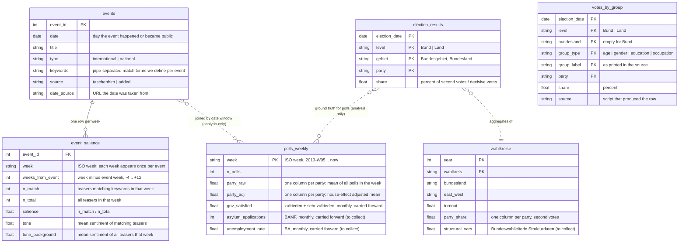

# Data model (processed layer)

Target tables in `data/processed/`, built by `src/preprocessing/` from the per-source CSVs in `data/interim/`.
Each table keeps its natural grain. Joins happen inside the analysis, not in storage.
All party tables carry every party, not only the AfD, so shifts between parties (e.g. AfD to BSW in 2024) stay visible.

Research question: *How can the growth of the AfD be explained?*
- Q1: Which international and national events had a significant impact on the AfD's success?
- Q2: How has the demographic profile of AfD voters changed?

Standard party columns everywhere: `CDU/CSU, SPD, Grüne, FDP, Linke, AfD, BSW, FW, Sonstige` (plus `SSW` and others where they occur).

## Diagram

## Tables

| Table | Grain | Built from | Serves |
|---|---|---|---|
| `polls_weekly` | one row per ISO week | `surveys_bund.csv`, `regierungszufriedenheit.csv`, controls to collect | Q1 outcome (all parties) and controls |
| `events` | one row per event | `events_taschenhirn.csv` plus dates and keywords added by `src/preprocessing/events.py` | Q1 treatments |
| `event_salience` | one row per event and week | `events`, `tagesschau_archiv.csv`, `tagesschau_sentiment.csv` | Q1 exposure |
| `votes_by_group` | one row per election, level, group type, group, party | `btw_gender_age.csv`, `btw_education.csv`, `ltw_age.csv`, `ltw_gender.csv`, `ltw_education.csv`, `tagesschau_umfrage-*.csv` | Q2 descriptive trend, flows between parties within a group |
| `election_results` | one row per election, area, party | `btw_results.csv`, `ltw_results.csv` | ground truth vs polls; Q1 and Q2 context |
| `wahlkreise` | one row per Wahlkreis and election | `btw_wahlkreise.csv`, structural data to collect | Q2 regression and map |

## Notes

- **House effects** (`party_adj`): each institute's mean deviation from the all-institute mean, per party, over the whole period is subtracted before averaging by week. The offsets are written to the decisions log.
- **Monthly controls** are carried forward to the weeks of the month they cover. This is stated wherever they are used.
- **Salience** is a share within the week, never a count, because the archive grows roughly tenfold between 2013 and 2025. `n_match` and `n_total` are kept so small denominators are visible. One row is one calendar week; `weeks_from_event` only aligns events on a common axis (week 0 = event week) so their coverage curves can be compared.
- **Event summaries** (peak salience, salience summed over a window) are derived from `event_salience` at the end of the pipeline, not stored on `events`, so there is one definition.
- **Keywords** are written by us per event and documented in `events`; they are not taken from a source.
- **`votes_by_group`** replaces the five wide interim tables with one long table with a `party` column. Group labels are kept as printed; harmonisation (e.g. 16-29 vs 18-29) is an analysis decision.
- **`wahlkreise`** gives 299 observations per federal election instead of 16 states, which is what makes a regression of party share on constituency characteristics possible, and drives the map in the dashboard.
- **Mixed grains** are intended: Q1 is answered at weekly grain, Q2 at election grain. The two meet only in the dashboard.
